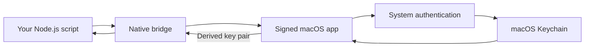

# keychain-wallet

**macOS Keychain-backed keys for Ethereum and Solana.**

[中文](README_ZH.md) · [Node.js API](node/README.md) · [Signing](docs/signing.md) · [Testing](docs/testing.md)

Store a recovery phrase in macOS Keychain. Authenticate with Touch ID or your Mac password, then use the derived key with your own viem, ethers, or Ed25519 code.

```ts
import { getKeyPair } from 'keychain-wallet';
import { Wallet } from 'ethers';

const { privateKey } = await getKeyPair({
  name: 'trading', // Create or import this wallet in the app first.
  curve: 'secp256k1',
  index: 2,       // m/44'/60'/0'/0/2
});

const wallet = new Wallet(privateKey);
console.log(wallet.address); // Never log the private key or wallet object.
```

https://github.com/user-attachments/assets/3554d122-92ed-412b-bce7-057f6dcdcdff

**Status: source preview.** Build instructions are available today. A notarized app download and a verified npm release are not provided by this checkout. Start with an unfunded test wallet; the project has not undergone an independent security audit.

## What it does

- Creates and imports English BIP-39 recovery phrases with an optional passphrase.
- Stores wallets behind macOS system authentication and a private Keychain access group.
- Lists wallet names and default Ethereum / Solana addresses without unlocking secrets.
- Reveals a recovery phrase or deletes a wallet after authentication and explicit user action.
- Returns secp256k1 or SLIP-0010 Ed25519 key pairs through a small Node.js API.

Useful for local scripts and developer tools that would otherwise keep a seed phrase or private key in a file. Once a key is returned, the calling process can use and retain it. This is a local key provider, not a hardware wallet or a remote signing service.

## How it works



The app owns Keychain access. The npm package starts the app's background mode when it needs a key; you do not need to keep a window open. Installing the npm package alone does not install the app.

## Try it from source

You need macOS 14+, Rust, Apple command-line development tools, Python 3, Node.js 22+, and the pnpm version pinned in `node/package.json`. The signed app also needs a certificate and provisioning profile: follow [the Personal Team setup](docs/signing.md) for local development. A paid Apple Developer Program membership is needed for Developer ID signing and notarized distribution; users of a future signed release will not need their own developer account.

1. Clone the repository:

   ```sh
   git clone https://github.com/nivek3/keychain-wallet.git
   cd keychain-wallet
   ```

2. Build the app using your signing identity, profile, and authorized bundle ID:

   ```sh
   bash scripts/build-native.sh \
     'Apple Development: Your Name (TEAMID)' \
     '/absolute/path/App.provisionprofile' \
     'com.example.keychain-wallet'
   open build/keychain-wallet.app
   ```

3. Click **+** and create or import a wallet named `trading`. For a new wallet, confirm all recovery words, or choose **Skip** to save without verifying the backup. You can view the phrase later through **Seed phrase**, after macOS authentication. For import, supply an independently known Ethereum address or Ed25519 public key to verify the restored account. Example names are not created automatically.

4. Build the SDK and run an example:

   ```sh
   pnpm --dir node install --frozen-lockfile --ignore-scripts
   pnpm --dir node run build
   cd node
   node --import tsx examples/ethers-v6.ts trading 2
   ```

   Complete the macOS authentication prompt. The example prints the Ethereum address for index `2`. Other examples: [ethers v5](node/examples/ethers-v5.ts), [viem](node/examples/viem.ts), [Ed25519](node/examples/ed25519.ts).

For another Node project, install the built SDK with `npm install /absolute/path/keychain-wallet/node`. Put the complete app bundle in `~/Applications` or `/Applications`, or pass its executable as `helperPath`. See the [API and troubleshooting guide](node/README.md).

## Derivation

`curve` is required. Derivation paths belong to the caller; recovering an existing account requires the original path and BIP-39 passphrase.

| Curve | Selection | Result |
| --- | --- | --- |
| `secp256k1` | `index: 2` | `m/44'/60'/0'/0/2`; index defaults to `0` |
| `secp256k1` | Explicit EVM `path` | Uses that path; do not also pass `index` |
| `ed25519` | Explicit hardened-only `path` | Uses that path; no implicit account-path choice |

```ts
const keys = await getKeyPair({
  name: 'trading',
  curve: 'ed25519',
  path: "m/44'/501'/2'/0'",
});
```

secp256k1 returns a 32-byte private scalar and a 33-byte compressed public key. Ed25519 returns a 32-byte child seed and a 32-byte public key. Both fields are `0x` hex strings. Ed25519 keys must be used with Ed25519 tooling, not ethers `Wallet`.

## Security boundaries

- Keychain uses `WhenUnlockedThisDeviceOnly`, user-presence access control, and a private access group. The display cache holds only names and public addresses.
- Recovery phrases are masked by default. Reveals expire after 60 seconds and clear on focus loss, navigation, or Hide. Explicit copies are cleared after 60 seconds while the app runs, before blocking authentication, or on normal exit, provided the clipboard still contains the app's latest copy. Copies retained by other software cannot be revoked.
- Node calls reuse a process-local macOS authentication context without caching keys or failures. In **… → Settings → Node authentication**, enter a custom duration in whole minutes (default: 5), then save. There is no policy maximum; `0` requires authentication on every call. App recovery-phrase reveals and deletions always authenticate separately. Deleting a wallet or locking the Mac cannot revoke keys already returned to your code.
- The SDK requires a logged-in macOS session for interactive authentication. It does not target browsers, Linux/Windows servers, or unattended jobs.
- Keep an independent offline recovery backup. A BIP-39 passphrase changes the wallet; it is not the Mac login password. Never share secrets in issues or logs.

## Development

```text
crates/app/       Rust desktop app and macOS Keychain integration
crates/crypto/    BIP-39 and key derivation
crates/node/      napi-rs bridge
node/            SDK, examples, and integration tests
scripts/         Build and packaging tools
tests/           Packaging tests
docs/            Signing and validation guides
```

See [testing](docs/testing.md) for local checks, [manual macOS release CI](docs/signing.md#manual-macos-release-ci) for signing configuration and App releases, and [Node packaging](node/README.md#development-and-publishing) for the npm release process. The app build uses Cargo and scripts; Xcode is needed for Personal Team provisioning, not as a project build system.

Bug reports should include macOS version, CPU architecture, Node/Bun version, app/SDK version, and the error code. Use public test fixtures for reproductions. Please report security issues through [GitHub private vulnerability reporting](https://github.com/nivek3/keychain-wallet/security/advisories/new).

## License

[MIT](LICENSE)
