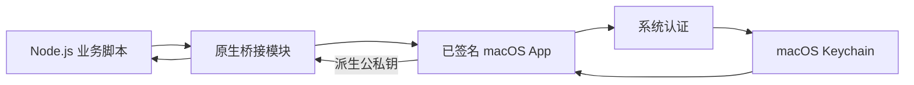

# keychain-wallet

**使用 macOS Keychain 管理 Ethereum 和 Solana 密钥。**

[English](README.md) · [Node.js API](node/README_ZH.md) · [签名配置](docs/signing.md) · [测试](docs/testing.md)

将助记词保存在 macOS Keychain，通过 Touch ID 或 Mac 登录密码认证，再把派生密钥交给自己的 viem、ethers 或 Ed25519 代码使用。

```ts
import { getKeyPair } from 'keychain-wallet';
import { Wallet } from 'ethers';

const { privateKey } = await getKeyPair({
  name: 'trading', // 先在 App 中创建或导入这个名称的钱包。
  curve: 'secp256k1',
  index: 2,       // m/44'/60'/0'/0/2
});

const wallet = new Wallet(privateKey);
console.log(wallet.address); // 不要输出私钥或整个 wallet 对象。
```

https://github.com/user-attachments/assets/3554d122-92ed-412b-bce7-057f6dcdcdff

**当前为源码预览版。** 可以按下文自行构建；当前仓库尚未提供经过公证的 App 下载或经过发布验证的 npm 版本。请先使用无资金的测试钱包，项目尚未接受独立安全审计。

## 能做什么

- 创建、导入英文 BIP-39 助记词，支持可选附加口令。
- 使用私有 Keychain 访问组保存钱包，通过系统认证读取。
- 免密浏览钱包名称及默认 Ethereum / Solana 地址。
- 认证并明确操作后显示助记词或删除钱包。
- 通过简单的 Node.js API 返回 secp256k1 或 SLIP-0010 Ed25519 公私钥。

适用于原本把助记词或私钥写在文件中的本机脚本和开发工具。密钥返回后，调用进程能够使用并保留它。项目是本机密钥提供器，不是硬件钱包或远程签名服务。

## 工作方式



App 负责 Keychain 访问。npm 包需要密钥时会启动 App 的后台模式，无需一直打开窗口。只安装 npm 包不会安装 App。

## 从源码开始

需要 macOS 14+、Rust、Apple 命令行开发工具、Python 3、Node.js 22+，以及 `node/package.json` 指定版本的 pnpm。App 还需要签名证书和 provisioning profile，本地开发可按[签名说明](docs/signing.md)配置免费 Personal Team。面向其他用户的 Developer ID 签名和公证需要发布方加入付费 Apple Developer Program；未来安装正式签名版本的用户无需自己的开发者账号。

1. 克隆仓库：

   ```sh
   git clone https://github.com/nivek3/keychain-wallet.git
   cd keychain-wallet
   ```

2. 使用自己的签名身份、profile 和获授权的 bundle ID 构建：

   ```sh
   bash scripts/build-native.sh \
     'Apple Development: Your Name (TEAMID)' \
     '/absolute/path/App.provisionprofile' \
     'com.example.keychain-wallet'
   open build/keychain-wallet.app
   ```

3. 点击 **+**，创建或导入名为 `trading` 的钱包。新建需要离线备份并确认全部助记词；导入需要提供来自可信备份的 Ethereum 地址或 Ed25519 公钥来核对账户。示例名称不会自动创建钱包。

4. 构建 SDK 并运行示例：

   ```sh
   pnpm --dir node install --frozen-lockfile --ignore-scripts
   pnpm --dir node run build
   cd node
   node --import tsx examples/ethers-v6.ts trading 2
   ```

   在本机完成认证，示例会输出 `index: 2` 的 Ethereum 地址。另有 [ethers v5](node/examples/ethers-v5.ts)、[viem](node/examples/viem.ts)、[Ed25519](node/examples/ed25519.ts) 示例。

在其他 Node 项目中使用 `npm install /absolute/path/keychain-wallet/node` 安装已构建 SDK。将完整 App 放进 `~/Applications` 或 `/Applications`，也可通过 `helperPath` 指定包内可执行文件。详见 [API 与故障排查](node/README_ZH.md)。

## 派生规则

`curve` 必传。派生路径由调用方决定；恢复现有账户必须使用原路径和 BIP-39 附加口令。

| 曲线 | 参数 | 结果 |
| --- | --- | --- |
| `secp256k1` | `index: 2` | `m/44'/60'/0'/0/2`；省略 index 时为 `0` |
| `secp256k1` | 完整 EVM `path` | 使用指定路径，不能同时传 index |
| `ed25519` | 完整 hardened-only `path` | 使用指定路径，不隐式选择账户路径 |

```ts
const keys = await getKeyPair({
  name: 'trading',
  curve: 'ed25519',
  path: "m/44'/501'/2'/0'",
});
```

secp256k1 返回 32 字节私钥标量和 33 字节压缩公钥；Ed25519 返回 32 字节子 seed 和 32 字节公钥，均为 `0x` hex。Ed25519 密钥应交给 Ed25519 工具，不能传给 ethers `Wallet` 来获得对应 Solana 账户。

## 安全边界

- 使用 `WhenUnlockedThisDeviceOnly`、用户在场认证和私有 Keychain 访问组。本机展示清单仅缓存名称与公开地址。
- 助记词默认遮罩。显示 60 秒、失焦、离开页面或点击 Hide 后清除。显式复制的内容在应用运行期间 60 秒后、阻塞认证前或正常退出时清理，前提是剪贴板仍为本应用最后一次写入。无法撤回其他软件保留的副本。
- Node 进程按选择参数缓存成功和失败的认证结果。修复不存在的钱包或取消认证后，应重新运行进程。删除钱包或锁屏不会撤回已经返回的密钥。
- SDK 需要已登录的 macOS 会话完成交互认证，不面向浏览器、Linux/Windows 服务或无人值守任务。
- 保留独立离线备份。BIP-39 附加口令会改变钱包，它不是 Mac 登录密码。不要在 issue 或日志中发送秘密。

## 开发

```text
crates/app/       Rust 桌面应用与 macOS Keychain 集成
crates/crypto/    BIP-39 与密钥派生
crates/node/      napi-rs 桥接
node/            SDK、示例与集成测试
scripts/         构建和打包工具
tests/           打包测试
docs/            签名与验证说明
```

本地检查见[测试说明](docs/testing.md)，App 的签名配置与手动发布见 [macOS 发布 CI](docs/signing.md#manual-macos-release-ci)，npm 发布见 [Node 打包说明](node/README_ZH.md#开发与发布)。App 使用 Cargo 和脚本构建，Xcode 用于 Personal Team provisioning，不作为仓库构建系统。

报告问题时请提供 macOS 版本、CPU 架构、Node/Bun 版本、App/SDK 版本及错误码。复现只使用公开测试数据；安全问题请使用 [GitHub 私密漏洞报告](https://github.com/nivek3/keychain-wallet/security/advisories/new)。

## 许可证

[MIT](LICENSE)
